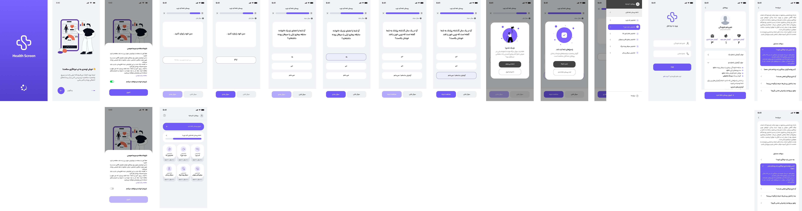

# Screening


Screening is a cross-platform Uno Platform mobile application designed to help users assess the likelihood of common health risks and disorders through guided questionnaires, risk scoring, and educational explanations.

The app currently supports screenings for:

- Diabetes risk
- Cardiovascular / heart disease risk
- Fracture risk
- Obesity risk
- Fatty liver risk
- General health evaluation with AI-assisted guidance

## Project purpose

This project is built to help people:

- answer a structured set of health screening questions
- understand relative risk indicators for several diseases
- receive general educational feedback based on their responses
- evaluate personal health concerns in a simple and accessible mobile experience

It is intended as a health-awareness and screening support tool, not as a medical diagnosis system.

## Technology stack

- Uno Platform
- .NET 9
- C# / XAML
- MVUX pattern
- Localization support
- Android-focused deployment with cross-platform capabilities

## App overview

The application uses a card-based interface to let users select the disease category they want to assess. Each screening flow asks relevant questions, calculates a risk estimate using project logic, and offers explanatory feedback to help users understand the result.

## Screenshots / app concept

The project includes themed cards and localized UI for health categories such as:

- diabetes
- heart health
- fracture risk
- obesity
- liver health

## Getting started

### Prerequisites

- .NET 9 SDK
- Visual Studio 2022 or JetBrains Rider
- Android SDK (for Android build and deployment)

### Restore and build

```bash
dotnet restore

dotnet build Screening.sln
```

### Run on Android

```bash
dotnet run -f net9.0-android --project Screening/Screening.csproj
```

## Project structure

```text
Screening/
  App.xaml
  Presentation/
  assets/
  Styles/
  Strings/
  Platforms/

Screening.Domain/
  Questionnaire/
  RiskCalculator/
  Models/
  Services/

Common/
  Abstraction/
  Services/

Screening.Tests/
  Unit and validation tests
```

## Important medical note

This application is intended for informational and educational use only. It does not replace professional medical advice, diagnosis, or treatment. Users should consult a licensed healthcare professional for diagnosis and treatment decisions.

## License

This project is licensed under the Creative Commons Attribution-NonCommercial-NoDerivatives 4.0 International License (CC BY-NC-ND 4.0).

Summary:

- You may view and use the code with attribution.
- You may not use it for commercial or business purposes.
- You may not modify and redistribute it under your own name or as a new project without permission.
- You must provide attribution to the original project.

See the full license in the [LICENSE](LICENSE) file and the official legal text:
https://creativecommons.org/licenses/by-nc-nd/4.0/

## Contact / ownership

This project is for educational and health-awareness use. If you plan to reuse or distribute it, please review the license terms and provide proper attribution.
